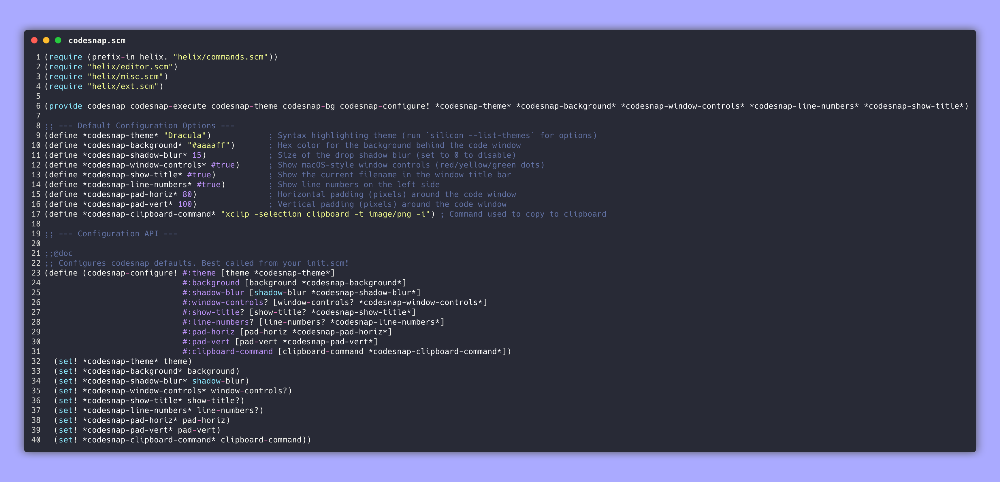
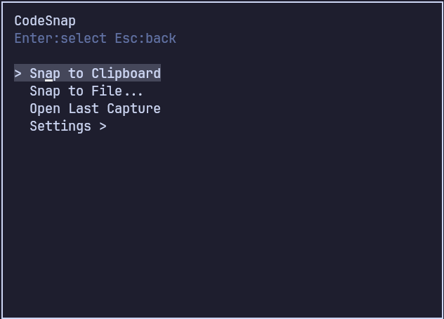
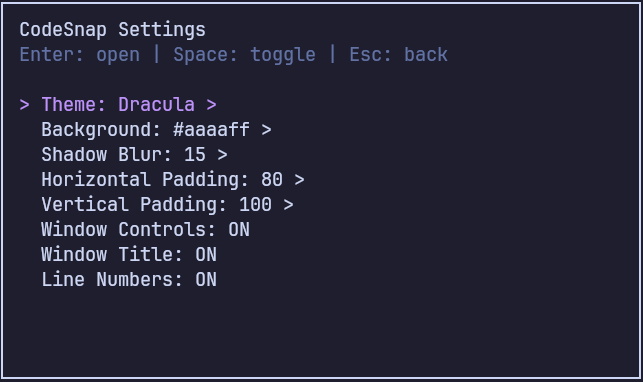
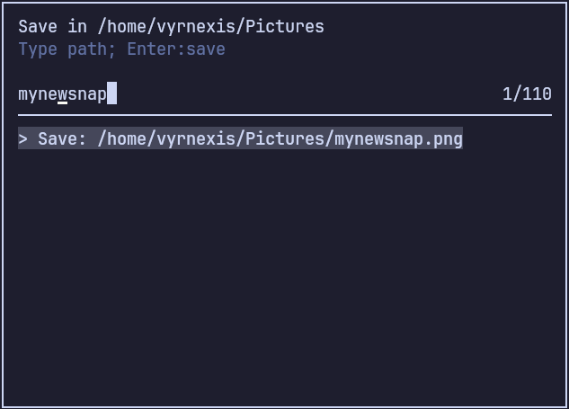
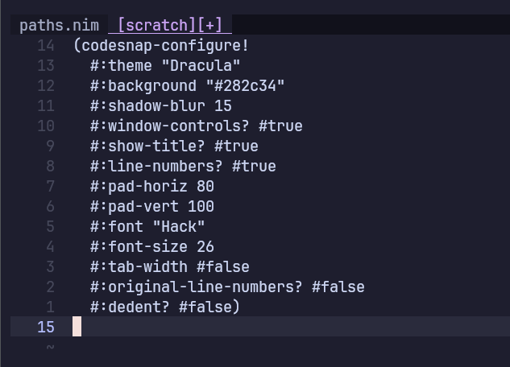

# codesnap.hx

[](https://github.com/Vyrnexis/codesnap.hx/actions/workflows/test.yml)



A plugin for [Helix](https://github.com/helix-editor/helix) using the [Steel plugin branch](https://github.com/mattwparas/helix/tree/steel-event-system) that renders selected code as an image.

Similar to CodeSnap or Polacode for VS Code, but for Helix. It pipes your current visual selection to [silicon](https://github.com/Aloxaf/silicon) to generate the image.

## Features

- Copy rendered code directly to the system clipboard.
- Complete save paths, suggest unique filenames, and remember the last save directory.
- Confirm overwrites and preserve existing images if rendering fails.
- Search installed themes and fonts; customize colors, font size, padding, and shadows.
- Follow editor tab width, optionally retain source line numbers, and remove common indentation.
- Preserve multiple selections without adding duplicate line breaks.
- Render asynchronously, prevent overlapping captures, and open the last saved image.
- Reset defaults or export current settings as a ready-to-copy configuration snippet.

## Interface

<p align="center">
  
  
</p>

<p align="center">
  
  
</p>

## Requirements

1. **Helix with Steel**: You need a build of Helix that includes the Scheme/Steel plugin system.
2. **Silicon**: Does the actual image generation.
   ```bash
   cargo install silicon
   ```

Silicon owns clipboard integration. On Linux, install the clipboard tool required by Silicon for your Wayland or X11 session.

## Installation & Setup

1. Install the plugin using `forge` (the Steel package manager):

```bash
forge pkg install --git https://github.com/Vyrnexis/codesnap.hx.git
```

2. Add these lines to your `~/.config/helix/helix.scm` file:

```scheme
(require (only-in "codesnap/codesnap.scm"
                  codesnap codesnap-configure! codesnap-reset codesnap-export codesnap-open-last))
(require (only-in "codesnap/codesnap-menu.scm" codesnap-menu))

;; Optional: Customize default settings (values shown are defaults)
(codesnap-configure! #:theme "Dracula"                 ; Syntax highlighting theme (run `silicon --list-themes` for options)
                     #:background "#aaaaff"            ; Hex color for the background behind the code window
                     #:shadow-blur 15                  ; Size of the drop shadow blur (set to 0 to disable)
                     #:window-controls? #t             ; Show macOS-style window controls
                     #:show-title? #t                  ; Show the filename in the window title bar
                     #:line-numbers? #t                ; Show line numbers on the left side
                     #:pad-horiz 80                    ; Horizontal padding (pixels) around the code window
                     #:pad-vert 100                    ; Vertical padding (pixels) around the code window
                     #:font "Hack"                     ; Bundled font; separate fallback families with semicolons
                     #:font-size 26                    ; Integer from 1 to 256
                     #:tab-width #f                    ; Follow editor/language settings; or set 1 to 255
                     #:original-line-numbers? #f        ; Start at the source line for a single selection
                     #:dedent? #f)                     ; Remove the common space/tab prefix

;; Export only the desired typed commands to the Helix command palette
(provide codesnap codesnap-menu codesnap-reset codesnap-export codesnap-open-last)
```

## Usage

Make a visual selection (`v` or `x`) of the code you want to capture, then open the command palette (`:`) and run:

- `:codesnap-menu` — Opens the interactive TUI control panel.

### The CodeSnap Menu

The `:codesnap-menu` is the main interface for captures and interactive settings.

**Navigation:**

- Use **Up / Down** arrows (or `j` / `k`) to navigate items.
- Use **Enter** to execute snap actions, open submenus, or apply a setting and return.
- Use **Space** to apply a non-searchable preset without closing, or toggle switches (ON/OFF).
- Use **Right** arrow (or `l`) to expand submenus.
- Use **Left** arrow (or `h` / `q`) to return to the parent menu or close the menu.
- Use **Escape** to return one level, or close the main menu.
- In searchable theme, font, and save pickers, letters and spaces enter text; use arrow keys to navigate and **Escape** to cancel.

**Actions:**

- **Snap to Clipboard**: Captures the selection and copies it to your clipboard.
- **Snap to File...**: Completes directories and image filenames as you type. Enter selects a directory or saves a file; missing extensions default to `.png`.
- **Open Last Capture**: Opens the last successfully saved image in your system viewer.
- **Settings >**: Opens the configuration submenu where you can change:
  - **Theme**, **Background** (including transparency), **Font**, and **Font Size**.
  - **Tab Width**, **Shadow Blur**, and horizontal/vertical **Padding**.
  - **Window Controls**, **Window Title**, **Line Numbers**, **Source Line Numbers**, and **Remove Common Indent**.
  - **Reset Defaults** and **Export Configuration**.

Pick **Custom...** to enter a color, font family, theme, or numeric value. Empty input or Escape leaves the setting unchanged. Menus resize to the available view.

The suggested filename contains the source name and timestamp, with a numeric suffix when needed. It starts in the last successful save directory, otherwise `~/Pictures` if available, or the current directory. Existing files require typing `yes` before replacement.

Settings and the last capture are remembered for the current editor session only. **Export Configuration** opens a scratch buffer; copy its contents into `helix.scm` to persist settings. It does not modify your configuration automatically.

**Source Line Numbers** applies only to a single selection, with line numbers enabled; multiple selections start at 1. **Remove Common Indent** removes the shared whitespace prefix while retaining relative indentation and line endings.

### Direct Commands

If you prefer to bypass the menu, you can use these commands directly:

- `:codesnap` — Captures the selection and copies it to your clipboard immediately using your current settings.
- `:codesnap <path>` — Saves to a specific file, confirming replacement when it exists (e.g. `:codesnap ~/Desktop/code.png`).
- `:codesnap-open-last` — Opens the last saved capture.
- `:codesnap-reset` — Restores rendering defaults.
- `:codesnap-export` — Opens the current configuration in a scratch buffer.

Quote paths containing spaces, for example `:codesnap "~/Desktop/code sample.png"`.

## Feedback and Errors

CodeSnap displays `rendering...` while Silicon runs and reports success only after checking its exit status and diagnostics. Missing Silicon, invalid settings, unsupported output paths, and clipboard failures are shown in the Helix status line. A second capture is rejected until the first completes; canceling a prompt never starts a capture.

Unsupported Helix language identifiers are retried using the current filename extension and then Markdown syntax.

CodeSnap isolates Silicon's CLI configuration so external defaults cannot conflict with plugin settings. Configure rendering through CodeSnap; installed Silicon fonts and themes remain available. Source text is streamed through stdin. Temporary diagnostic files are cleaned up, and file captures are staged beside their destination before publication, keeping an existing image intact on render failure.

## Development

Run the core and subprocess regression checks (Steel plus a POSIX shell; no Silicon or clipboard required):

```bash
steel tests/codesnap-core-test.scm
mkdir -p .test-work/tmp
PATH="$PWD/tests/fixtures:$PATH" \
TMPDIR="$PWD/.test-work/tmp" \
SILICON_CONFIG_PATH="$PWD/tests/fixtures/silicon-config" \
steel tests/codesnap-process-test.scm
```

For a manual Helix smoke test, launch your Steel-enabled Helix with `HELIX_STEEL_CONFIG="$PWD/tests/helix" hx --config tests/helix/config.toml tests/codesnap-core-test.scm`. The pinned `ui-utils.hx` dependency must already be installed. Select a line, test the save picker and overwrite cancellation, search themes, and export settings. Keep test images under the ignored `.test-work/` directory.

With `.test-work/` created and Silicon installed, run `:codesnap-check-start` on a selection, wait for the saved status, then run `:codesnap-check-finish`. These test-only commands check atomic configuration validation, overlapping-capture rejection, file publication, selection preservation, and reset behavior.

## Updating

To pull the latest updates for the plugin, run the install command again with the `--force` flag:

```bash
forge pkg install --git https://github.com/Vyrnexis/codesnap.hx.git --force
```

## License

[MIT](LICENSE)
